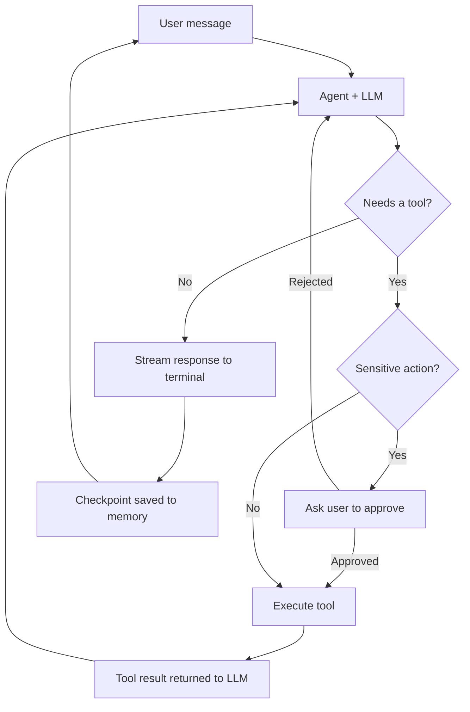

# Rogue: An Interactive Coding Agent

Rogue is a command-line coding agent built with **Python**, **LangChain**, and **LLM tool calling**. You chat with it in a terminal session, and it plans and carries out coding tasks for you: creating and editing files, inspecting your project, and running commands or servers. Sensitive actions pause for your approval before they execute.


---

## Demo

<!--
Option A (best): drag your .mp4 into a GitHub issue or PR comment box, copy the generated
"user-attachments" URL, and paste it on its own line below. GitHub renders it as an inline player.

Option B: use a clickable thumbnail linked to YouTube:
[](https://youtu.be/YOUR_VIDEO_ID)
-->

[](https://www.youtube.com/watch?v=2ea6dgK6CC4)

---

## What Rogue Does

- **Multi-turn chat loop.** The session keeps running across many requests until you type `exit`, so you can iterate on a project the way you would with a pair programmer.
- **Autonomous tool use.** The model decides which tool to call, reads the result, and keeps going until the task is done.
- **Real-time streaming.** Responses stream to the terminal chunk by chunk instead of appearing all at once.
- **Short-term memory.** Conversation state is saved with checkpointers, so the agent remembers earlier instructions and results within a session.
- **Human-in-the-loop safety.** Sensitive tool calls require your approval before they run.
- **Prompt templates.** Agent behavior is defined in modular **Jinja2** templates (see [`prompts/`](prompts/)), so it can be adjusted without touching code.

## Tools the Agent Can Use

| Capability | Description |
|---|---|
| Create files | Write new source files and configs |
| Edit files | Modify existing files in place |
| List files | Browse the project directory |
| Working directory | Check where the agent is operating |
| Run commands / servers | Execute shell commands and start local servers |

<!-- Add or rename rows to match the tool names in src/. -->

## Language Support

Rogue is **language-agnostic**. The agent writes and edits plain files, so it can work in any language the underlying LLM can generate.

**Tried so far:** [list the languages and project types you've tested, e.g. Python, JavaScript/TypeScript, C++, HTML/CSS]

## Tech Stack

| Layer | Technology |
|---|---|
| Language | Python 3.14+ |
| Agent framework | LangChain |
| LLM provider | Groq (via `langchain-groq`), model: `[model name]` |
| Prompting | Jinja2 templates |
| Memory | LangChain checkpointers (`[in-memory / SQLite / other]`) |
| Safety | Human-in-the-loop middleware |
| Packaging | uv |
| Config | python-dotenv |

## Middleware

| Middleware | Purpose |
|---|---|
| **Human-in-the-loop (HITL)** | Pauses before sensitive tool calls (`[list which tools]`) and lets you approve or reject them |
| `[other middleware, if any]` | `[what it does]` |

## How It Works



The agent loops between the model and its tools until it can answer, then streams the reply and waits for your next message.

## Getting Started

**Prerequisites:** Python 3.14+, [uv](https://docs.astral.sh/uv/), and a [Groq API key](https://console.groq.com/).

```bash
# 1. Clone the repository
git clone https://github.com/Shubhii-A2Z/Rogue.git
cd Rogue

# 2. Install dependencies
uv sync

# 3. Configure your API key
cp .env.example .env
# open .env and add your Groq API key

# 4. Run the agent
uv run src/main.py
```

Type your request at the prompt. Type `exit` to end the session.

## Try Asking

- "Create a small Flask app with a `/health` route and run it."
- "List the files in this directory and explain the project structure."
- "Add input validation to `app.py` and show me what changed."

## Project Structure

```
Rogue/
├── prompts/          # Jinja2 prompt templates
├── src/              # Agent, tools, and middleware
├── .env.example      # Environment variable template
├── pyproject.toml    # Dependencies and entry point
└── uv.lock           # Locked dependency versions
```

## About

Built by **Shubham Negi**, a Computer Science student at Delhi Technological University.

[GitHub](https://github.com/Shubhii-A2Z) · [LinkedIn](https://www.linkedin.com/in/shubhamnegi23/) · negishubham2005@gmail.com